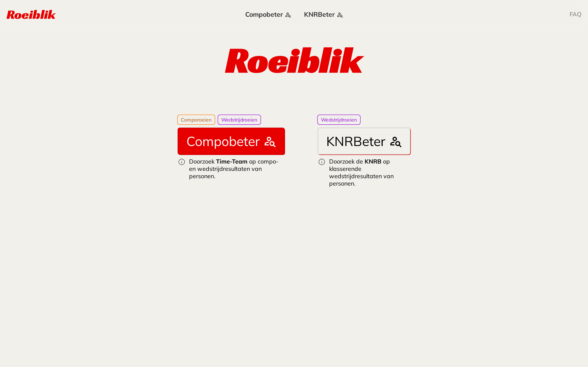
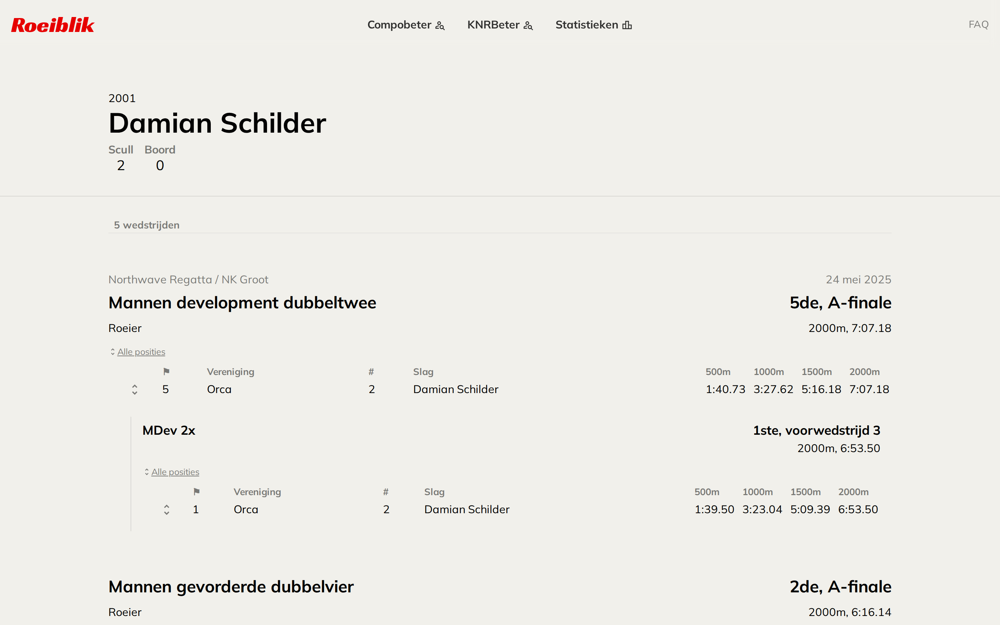
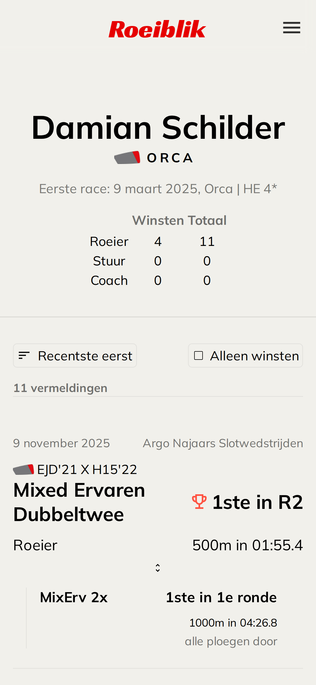
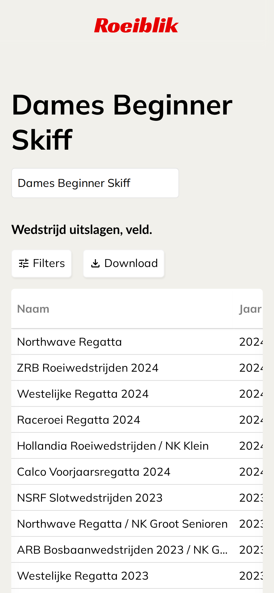

# Roeiblik

**[roeiblik.com](https://roeiblik.com)**: Dutch rowing results, searchable by person.

Rowers, coxes and coaches race under many club and crew names. Their results are spread over
Time-Team (competition and regattas) and the KNRB's own results site. Roeiblik puts a person's
races on one page, with times per 500 m, every round of a race, and their crewmates.

| | |
|---|---|
| **Compobeter** | Search Time-Team for anyone's competition and regatta results. |
| **KNRBeter** | Search the KNRB's classified results: every race, heat and final, with positions and split times. |
| **Statistieken** | National KNRB statistics per event: winning and average times per year, and club win rates. |

<p>
  
</p>
<p>
  
  
  
</p>

## How it was built

- **November 2024 to April 2025**, 121 commits. A hybrid: the frontend (pages, components,
  styling, the logic that groups a person's races) was written by hand. The server routes that
  talk to the Time-Team and KNRB APIs were written with help from browser-based Gemini.
- **November 2026, maintenance with Claude Code**, to put the site back online safely. It covered
  the security and privacy work below, plus an upgrade from Nuxt 3.14 to Nuxt 4.6 and current
  versions of every dependency. The look and the way the site works did not change.

## Stack

Nuxt 4 (Vue 3, server-side rendering), Pinia, Pug and SCSS templates, Chart.js, and csv-parse for
the statistics. The Nitro server runs on Cloudflare Workers with static assets.

## Security and privacy

- **No database, no accounts, no cookies.** The server passes each search on to Time-Team or the
  KNRB (via Foys) and keeps the answer for at most ten minutes in a small in-memory cache, capped
  at 500 entries.
- **Every API route validates its input.** An id must match `[A-Za-z0-9_-]{1,64}`, a race id must
  be numeric, and a search term must be 2–100 characters. Values are URL-encoded before they reach
  an upstream URL, so the server cannot be used as a proxy to other paths on those APIs.
  Upstream errors are logged by host and path only and never sent to the browser.
- **Security headers** on every response: `X-Content-Type-Options`, `Referrer-Policy`,
  `X-Frame-Options`, `Permissions-Policy`, HSTS and a CSP with `frame-ancestors 'none'`.
- **Person pages are `noindex`**, via both a header and a meta tag. People can be found by searching
  on Roeiblik, not through search engines.
- **Removal on request.** The ids in `NUXT_BLOCKED_PERSON_IDS` disappear from search results and
  their person pages return nothing. See the [privacy page](https://roeiblik.com/privacy) (in Dutch).
- **Cookieless analytics**, optional: Cloudflare Web Analytics, with no cookies and no personal
  data, so no consent banner is needed.
- The statistics only use aggregate CSVs per event and club. Per-rower datasets are not published.

## Run it locally

Requires Node.js 22 or newer.

```sh
npm install
npm run dev        # http://127.0.0.1:3000
```

## Configuration

| Variable | Purpose |
|---|---|
| `NUXT_BLOCKED_PERSON_IDS` | Comma-separated Time-Team and KNRB person ids to hide (removal requests). |
| `NUXT_PUBLIC_CF_BEACON_TOKEN` | Cloudflare Web Analytics token. Empty means no analytics script. |
| `NUXT_CANONICAL_HOST` | The one host the site answers on; other hosts get a 301 to it. Set to `roeiblik.com` by the Worker config. |

## Deploy (Cloudflare Workers)

```sh
npx wrangler login     # once
npm run deploy         # nuxt build, then wrangler deploy
```

- The build writes the Worker config (`.output/server/wrangler.json`) from `nuxt.config.ts`
  (`nitro.cloudflare.wrangler`): Worker `roeiblik` on the custom domains `roeiblik.com` and
  `www.roeiblik.com`, with the `*.workers.dev` address and preview URLs switched off. The site is
  only reachable on roeiblik.com; www and any other host get a 301 there. roeiblik.nl has its own
  redirect rule in Cloudflare.
- A custom domain can't be created on a hostname that still has a CNAME record: delete that record
  in Cloudflare DNS before the first deploy.
- Set `NUXT_BLOCKED_PERSON_IDS` and `NUXT_PUBLIC_CF_BEACON_TOKEN` as Worker variables (Settings →
  Variables). `keep_vars` makes deploys leave them alone.
- Recommended: a Cloudflare rate-limiting rule on `/api/*` (Security → WAF → Rate limiting rules),
  e.g. 60 requests per minute per IP. It stops anyone from scraping Time-Team or the KNRB through
  Roeiblik.

## Data sources

Results come from [Time-Team Regatta Systems](https://time-team.nl/) and the
[KNRB](https://roeievenementen.knrb.nl/) (via Foys). Roeiblik is an independent hobby project and
is not affiliated with either.
